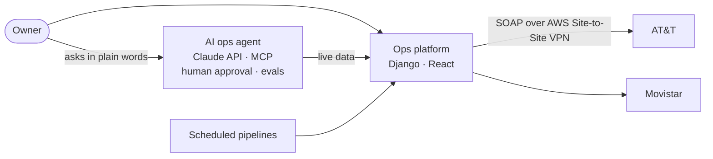
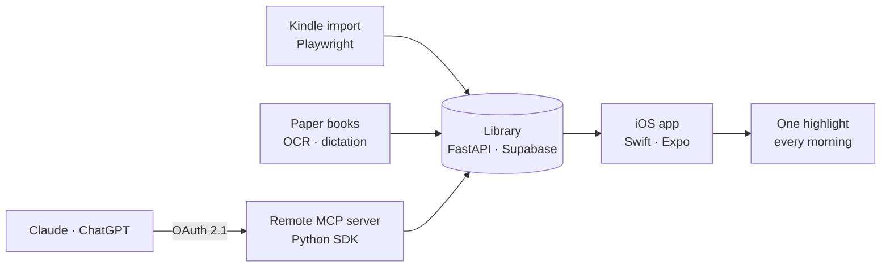
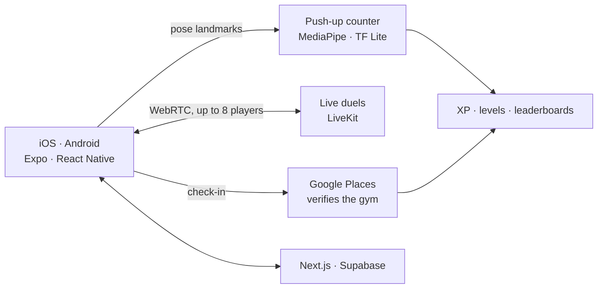

# Hi, I'm Carlos.

Full-stack and forward deployed engineer in Mexico. I talk to whoever has the problem, then build and run the fix.

Six years with Python, Django, React, TypeScript and AWS. I build web and mobile apps, automations and AI agents, and I've led a team of five engineers. Open to remote roles and freelance projects, in Mexico and abroad.

[carlosnava.dev](https://www.carlosnava.dev) · [CV](https://www.carlosnava.dev/cv) · [LinkedIn](https://www.linkedin.com/in/carlosnavam) · [hello@carlosnava.dev](mailto:hello@carlosnava.dev) · [Español](https://www.carlosnava.dev/es)

## Now

A telecom operations platform I built on my own, for a client under NDA: SIM activations and prepaid recharges on AT&T and Movistar. Operating time is down **60%**, it processes about **MXN $1M** a month, and **96%** of activations and recharges succeed.

- I worked with AT&T engineers on the SOAP client and a secure AWS Site-to-Site VPN.
- An AI ops agent on the Claude API, with tool use and MCP, answers the owner's questions from live data. Corrective actions wait for a human, and an eval set measures its accuracy.
- Domain-Driven Design, TDD and Spec-Driven Development, with scheduled data pipelines and dashboards for sales, inventory and system health.
- I run it in production: monitoring, incidents and fixes.

## My apps

<table>
<tr>
<td width="50%" valign="top">

**[Relic](https://therelic.app)** · iOS, 2025 – now 
A reading app with paying subscribers in the US, Mexico and Taiwan. Its remote MCP server, with OAuth 2.1, is listed in the Claude and ChatGPT directories. About 15,000 lines of Swift and 1,800 automated tests.

Swift · Expo · FastAPI · Supabase · Playwright · RevenueCat
</td>
<td width="50%" valign="top">

**[Gym Wigas](https://gymwigas.app)** · iOS and Android, 2026 – now 
A virtual gym: your character levels up when you train. Live video duels for up to 8 players, push-ups counted by the camera, and gym check-ins verified with Google Places.

Next.js · Expo · Supabase · LiveKit · MediaPipe · Stripe
</td>
</tr>
</table>

<b>How each one is built</b>

#### Telecom operations platform

#### Relic

#### Gym Wigas

## Experience

| Years | Company | Role | Result |
|---|---|---|---|
| 2025&nbsp;–&#8288;&nbsp;now | Freelance | Forward Deployed Engineer | The telecom platform above, plus apps and automations for small businesses |
| 2024&nbsp;–&#8288;&nbsp;25 | Alluxi | Software Engineer | Recruitment platform on the OpenAI API, candidate classification 80% more accurate |
| 2023&nbsp;–&#8288;&nbsp;24 | Jüsto | Backend Developer | Backend 30% faster, 40% of manual warehouse work automated |
| 2023 | Scitum | Cybersecurity Engineer | Incident response automated with xSOAR and Python, 60% faster |
| 2021&nbsp;–&#8288;&nbsp;23 | Alluxi | Full-Stack Engineer, Team Lead | Led 5 engineers; flight bookings at 50,000+ a month, 30% less downtime |
| 2021 | Nómada | Full-Stack Engineer | HR platform with React, GraphQL and Go |
| 2020&nbsp;–&#8288;&nbsp;21 | Sysy.mx | Backend Developer | Scraping bots for insurance data, 70% less manual work |

B.Sc. Software Engineering, UANL · Native Spanish, professional English · [Full CV](https://www.carlosnava.dev/cv)

## Skills

**Languages** · Python, TypeScript, JavaScript, Go, Swift, SQL 
**Backend** · Django, FastAPI, REST, GraphQL and SOAP APIs, PostgreSQL, MongoDB, Supabase 
**Frontend and mobile** · React, Next.js, Vue, Nuxt, Angular, React Native, Expo, native iOS in Swift 
**AI and automation** · Claude API, OpenAI API, AI agents, tool use, MCP servers, LLM evals, web scraping, data pipelines, OpenCV, MediaPipe 
**Cloud and DevOps** · AWS (EC2, S3, Site-to-Site VPN), Docker, Render, GitHub Actions, CI/CD, Linux 
**Practices** · Domain-Driven Design, Test-Driven Development, Spec-Driven Development, Scrum

## On GitHub

Contributions to this account per year. Most of it lands in private repositories: client work under NDA and my own apps. 2026 is counted to November 24, with 2,903 commits and 229 pull requests so far.

<picture>
  <source media="(prefers-color-scheme: dark)" srcset="assets/contributions-dark.svg">
  
</picture>

Public projects

- [fake-news-detection](https://github.com/yeguacelestial/fake-news-detection): Django web app that flags fake news with a passive-aggressive classifier
- [amram-ai](https://github.com/yeguacelestial/amram-ai): desktop app that splits a song into stems with Demucs, fully offline
- [reservamos-challenge](https://github.com/yeguacelestial/reservamos-challenge): Django REST API that compares weather forecasts across destinations
- [puul-challenge](https://github.com/yeguacelestial/puul-challenge): task management API with NestJS and Docker
- [podcast-multicam-editor](https://github.com/yeguacelestial/podcast-multicam-editor): cuts between two cameras based on who is speaking
- [mclp-sto](https://github.com/yeguacelestial/mclp-sto): heuristics for the Maximal Covering Location Problem

Away from the keyboard: guitar, piano, orchestral music, books and the gym. Relic came from the books, Gym Wigas from the gym.
