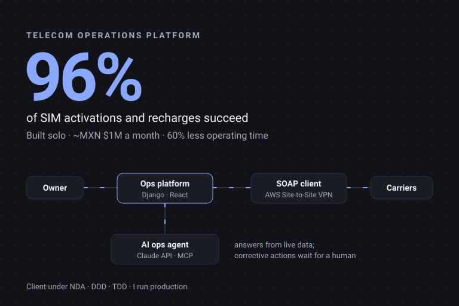
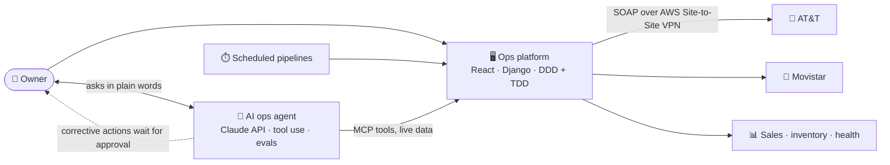
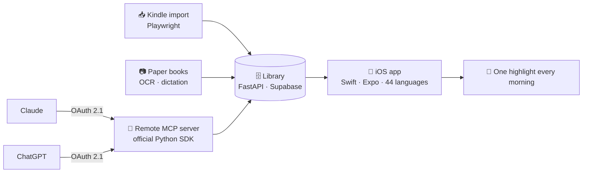
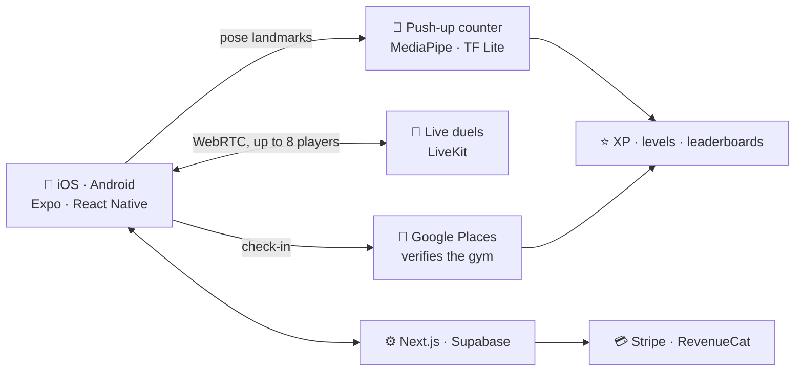

<picture>
  <source media="(prefers-color-scheme: dark)" srcset="assets/header-dark.svg">
  
</picture>

  
  
  
  
  

👋 **Senior full-stack engineer** and **forward deployed engineer** in Mexico 🇲🇽 with **6 years** shipping production software in **Python / Django**, **TypeScript / React / Next.js**, **React Native and Swift (iOS)** and **AI agents (Claude API, OpenAI API, MCP)** on **AWS**. I sit with the people who have the problem, then design, build, deploy and run the fix. I've also led a team of five. 🌎 Open to **remote** roles (US · Mexico · LATAM) and freelance projects.

## 🚀 Building now

<table>
<tr>
<td width="33%" valign="top">

**📡 Telecom ops platform** 
Freelance · client under NDA · 2025 – now

SIM activations and recharges on AT&T and Movistar, built solo from discovery to production. **96%** success, **~MXN $1M** a month, **60%** less operating time.

`Django` `React` `AWS VPN` `SOAP` `Claude API` `MCP`
</td>
<td width="33%" valign="top">

**📚 [Relic](https://therelic.app)** 
iOS · founder, solo dev · 2025 – now

Brings back your book highlights every morning. Paying subscribers in 🇺🇸 🇲🇽 🇹🇼. Its MCP server is listed in the Claude and ChatGPT directories. ~15K lines of Swift, ~1,800 tests.

`Swift` `Expo` `FastAPI` `Supabase` `MCP` `OAuth 2.1`
</td>
<td width="33%" valign="top">

**🏋️ [Gym Wigas](https://gymwigas.app)** 
iOS + Android · founder, solo dev · 2026 – now

A fitness game: your character levels up only when you really train. Live video duels for 8, push-ups counted by the camera, verified gym check-ins. 898 commits in 43 days.

`Next.js` `Expo` `Supabase` `LiveKit` `MediaPipe` `Stripe`
</td>
</tr>
</table>

🏗️ <b>Under the hood:</b> how each one is built

#### 📡 Telecom ops platform

#### 📚 Relic

#### 🏋️ Gym Wigas

## 📈 Results I've shipped

<picture>
  <source media="(prefers-color-scheme: dark)" srcset="assets/impact-dark.svg">
  
</picture>

## 🧰 Stack

<picture>
  <source media="(prefers-color-scheme: dark)" srcset="https://skillicons.dev/icons?i=py%2Cts%2Cjs%2Cgo%2Cswift%2Cdjango%2Cfastapi%2Cgraphql%2Cpostgres%2Cmongodb%2Csupabase%2Creact%2Cnextjs%2Cvue%2Cnuxtjs%2Cangular%2Caws%2Cdocker%2Cgithubactions%2Clinux%2Cgit%2Ctensorflow%2Copencv&perline=12&theme=dark">
  
</picture>

🔎 Senior Full-Stack Engineer · Forward Deployed Engineer · Backend Engineer · AI Engineer · Python · Django · FastAPI · TypeScript · React · Next.js · React Native · Expo · Swift · iOS · PostgreSQL · Supabase · MongoDB · REST · GraphQL · SOAP · AWS (EC2, S3, VPN) · Docker · CI/CD · GitHub Actions · LLM · AI agents · Claude API · OpenAI API · Model Context Protocol (MCP) · OAuth 2.1 · Playwright · web scraping · data pipelines · Domain-Driven Design · TDD · Spec-Driven Development · remote · Mexico · LATAM · English · Spanish

## 💼 Experience

| 📅 | 🏢 | 👨‍💻 Role | 📈 Impact |
|---|---|---|---|
| 2025 – now | Freelance | Forward Deployed Engineer | Telecom ops platform built solo · AI ops agent on Claude + MCP |
| 2024 – 25 | Alluxi | Software Engineer | AI recruiting on the OpenAI API, **80%** more accurate classification |
| 2023 – 24 | Jüsto | Backend Developer | Backend **30%** faster, **40%** of warehouse work automated |
| 2023 | Scitum | Cybersecurity Engineer | Incident response on Cortex xSOAR + Python, **60%** faster |
| 2021 – 23 | Alluxi | Full-Stack Engineer · Team Lead | Led **5** engineers · **50K+** bookings a month, **30%** less downtime |
| 2021 | Nómada | Full-Stack Engineer | HR platform with React, GraphQL, Go and AWS |
| 2020 – 21 | Sysy.mx | Backend Developer | Scraping bots for insurance data, **70%** less manual work |

🎓 B.Sc. Software Engineering, UANL · 🗣️ Spanish (native), English (professional) · 📄 [Full CV](https://www.carlosnava.dev/cv)

## 📊 Activity

<picture>
  <source media="(prefers-color-scheme: dark)" srcset="assets/activity-dark.svg">
  
</picture>

<picture>
  <source media="(prefers-color-scheme: dark)" srcset="https://raw.githubusercontent.com/yeguacelestial/yeguacelestial/output/snake-dark.svg">
  
</picture>

🗂️ <b>Public projects</b> (most of my code is private: client work under NDA and my own apps)

- 📰 [fake-news-detection](https://github.com/yeguacelestial/fake-news-detection): Django web app that flags fake news with a passive-aggressive classifier
- 🎵 [amram-ai](https://github.com/yeguacelestial/amram-ai): desktop app that splits a song into stems with Demucs, fully offline
- 🌦️ [reservamos-challenge](https://github.com/yeguacelestial/reservamos-challenge): Django REST API that compares weather forecasts across destinations
- ✅ [puul-challenge](https://github.com/yeguacelestial/puul-challenge): task management API with NestJS and Docker
- 🎙️ [podcast-multicam-editor](https://github.com/yeguacelestial/podcast-multicam-editor): cuts between two cameras based on who is speaking
- 📍 [mclp-sto](https://github.com/yeguacelestial/mclp-sto): heuristics for the Maximal Covering Location Problem

🎸 guitar · 🎹 piano · 🎻 orchestral music · 📚 books (where Relic came from) · 🏋️ the gym (where Gym Wigas came from)

